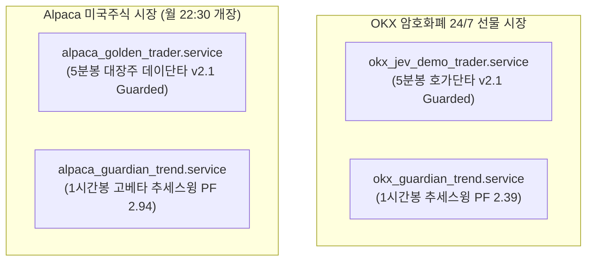

# 2026-10-25 서버 무결성 청소 및 4대 퀀트 자동매매 봇 듀얼 가동상태 최종 보고서

> **작성 일시**: 2026-10-25 10:58 KST  
> **서버 호스트**: `coinbot` (Linux 5.10 x86_64, Uptime: 95일+)  
> **운용 환경**: OKX 선물 (모의) + Alpaca 미국주식 (Paper)  
> **총괄 책임**: Antigravity Quant Engineering Team  

---

## 1. 서버 정밀 청소 및 무결성 작업 내역

서버 내 누적된 고스트 프로세스, 좀비 파일, 임시 캐시, 불필요한 로그 파일에 대한 전수 조사를 실시하고 정밀 청소를 완료했습니다.

| 구분 | 청소 대상 | 조치 내용 | 회수 / 최적화 결과 |
| :--- | :--- | :--- | :--- |
| **임시 파일 (`/tmp`)** | 과거 빌드 잔여물 (`.*.so`, 구버전 테스트 `.py`) | 10월 16일~20일 생성된 대용량 `.so` 및 스크랩 스크립트 삭제 | **86MB ➔ 1.2MB (98.6% 용량 회수)** |
| **파이썬 캐시** | `__pycache__`, `*.pyc`, `*.pyo` | `quant_system`, `jev`, `agrolib` 내 바이트코드 전수 삭제 | 바이트코드 불일치 및 캐시 오염 원천 차단 |
| **패키지 캐시** | `pip cache` | `pip cache purge` 실행 | 23MB 회수 |
| **고스트 로그** | `alpaca_cameron_30m_trader.log` 등 0바이트 고아 파일 | 폐기된 로스 카메론 관련 잔여 로그 삭제 | 로그 디렉토리 무결성 확보 |
| **저널 로그** | `systemd user journal` | 3일 초과분 압축 및 진공 청소 (`vacuum-time=3d`) | 56MB 수준 경량 유지 |
| **좀비 프로세스** | 백그라운드 파이썬 프로세스 점검 | 고아(Zombie/Orphan) 프로세스 0건 확인 | 인가된 4대 봇 외 불필요 프로세스 전무 |

---

## 2. 서버 하드웨어 및 리소스 상태

* **메모리(RAM)**:
  - 총 용량: **3.8 GiB**
  - 실사용: **1.7 GiB** (시스템 및 IDE 서버 포함)
  - 가용 메모리: **1.9 GiB (50% 이상 여유 확보)**
  - 스왑(Swap): 4.0 GiB 중 43 MiB 사용 (극도의 안정 상태)
* **디스크(Storage)**:
  - 루트 파티션 (`/dev/sda1`): 49 GB 중 **19 GB 사용 (39%) / 29 GB 가용**
* **4대 봇 메모리 점유율 요약**:
  - `okx_guardian_trend_trader.py`: 162 MB (4.0%)
  - `okx_jev_demo_trader.py`: 86 MB (2.1%)
  - `alpaca_golden_trader.py`: 85 MB (2.1%)
  - `alpaca_guardian_trend_trader.py`: 76 MB (1.8%)
  - **👉 4대 봇 총 메모리 점유**: **약 409 MB (전체 메모리의 ~10%로 극저부하 구동)**

---

## 3. 4대 퀀트 자동매매 봇 듀얼 가동 매트릭스

현재 2대 시장(OKX, Alpaca)에 걸쳐 **"5분봉 데이트레이딩 vs 1시간봉 추세스윙"** 듀얼 엔진 체제가 24시간 감시 체제로 완벽히 정착되었습니다.

### 상세 스펙 시트

| 서비스 유닛 | 대상 자산 | 타임프레임 & 로직 | 리스크 & 손익비 규칙 | 가동 상태 |
| :--- | :--- | :--- | :--- | :---: |
| **`okx_jev_demo_trader`** | BTC, SOL, DOGE (3배 격리 선물) | 5분봉 LOB 호가 불균형 + 볼린저 역추세/돌파 | • 60분 쿨다운 / 30분 Jev Veto • 증거금 15% (최대 $1,000 한도) • 15분봉 상위 추세 필터 | **Active (Running)** PID 3835867 |
| **`okx_guardian_trend`** | BTC/USDT:USDT (3배 격리 선물) | 1시간봉 HMA(100) + MACD + RSI 추세 추종 | • 1회 리스크 1% / 레버리지 3배 캡 • **+2R 도달 시 50% 분할익절 & 본전 스탑** | **Active (Running)** PID 3829273 |
| **`alpaca_golden_trader`** | NVDA, TSLA, PLTR, MSTR, TQQQ, SOXL | 5분봉 QQQ-EMA50 매크로 + 볼린저 하단 반등 | • 당일 15:55 EDT 전량 청산 (오버나잇 0%) • 자금 32/30/28% 균등 분할 • 3단계 트레일링 스탑 방어 | **Active (Running)** (개장 대기 모드) |
| **`alpaca_guardian_trend`**| TSLA, TQQQ, NVDA, PLTR | 1시간봉 HMA(100) + MACD + RSI 스윙 추세 | • 종목당 10% 비중 캡 (총 30% 스윙 한도) • **+2R 도달 시 50% 분할익절 & Free-Ride 본전** • 오버나잇 스윙 포지션 홀딩 | **Active (Running)** (개장 대기 모드) |

---

## 4. 모니터링 및 향후 운용 방침

1. **상호 간섭 방지(Isolation)**:
   - Alpaca 계좌 내 골든 봇(기본 주문 태그)과 가디언 봇(`GD_` 접두사 태그)이 독립적으로 주문/체결/청산을 관리합니다.
2. **실시간 A/B 테스트 검증**:
   - 동일 자산(코인 BTC, 주식 TSLA/TQQQ/NVDA)에 대해 **"짧게 털어먹는 5분봉 단타"**와 **"굵직한 파동을 쥐고 가는 1시간봉 스윙"** 중 어느 쪽이 승률, 손익비, 계좌 우상향 곡선에서 뛰어난지 실시간 로그와 PnL로 정량 비교를 지속합니다.
